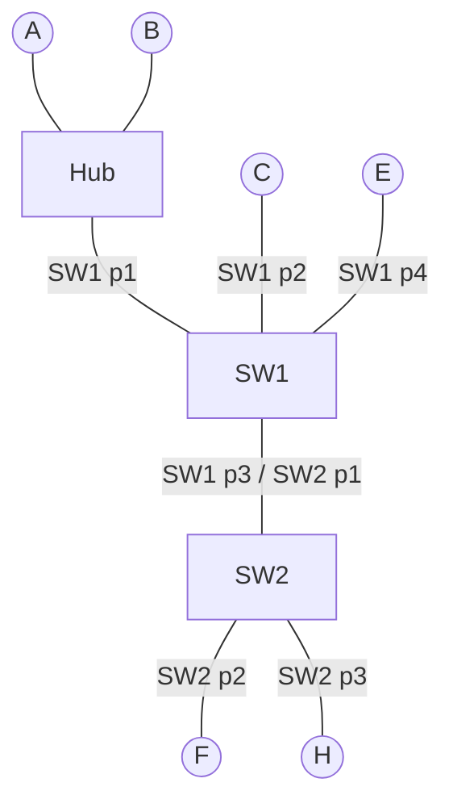
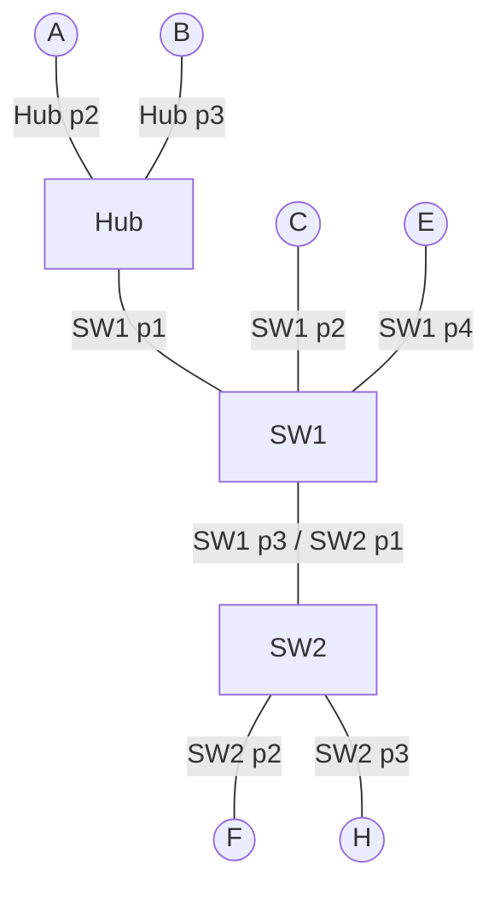
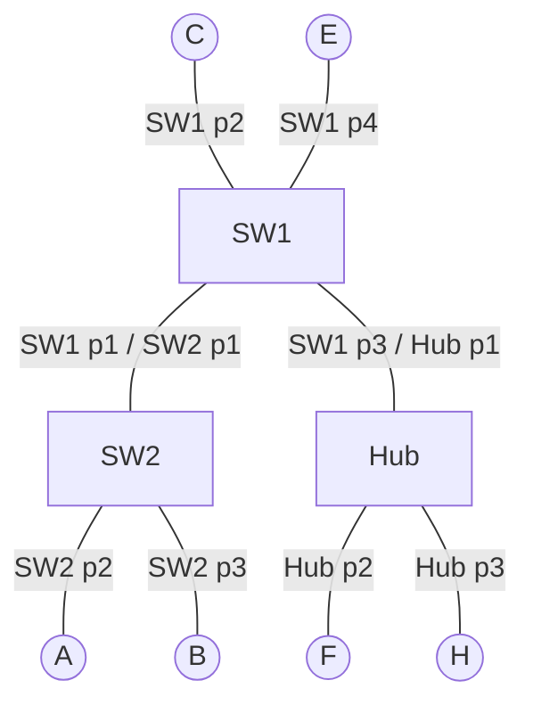

# Switches, Hub y ARP: ejercicios resueltos

Tres ejercicios de transmisiones secuenciales sobre redes con hub y switches. El primero es sin ARP (el switch aprende solo con las tramas de datos); el segundo y el tercero usan ARP.

---

## 1. Teoría base

### Los tres tipos de equipo

| Equipo | Tabla | Qué guarda | Dura |
|---|---|---|---|
| **Hub** | ninguna | nada: repite la trama por todos sus puertos menos el de entrada | - |
| **Switch** | `T-conm` (conmutación) | MAC → puerto | 5 min, volátil |
| **Host (PC)** | `T-arp` | IP → MAC | ~3 min, volátil (cifra del curso) |

### Unicast vs broadcast

| | MAC destino | Quién la procesa | Qué hace el switch |
|---|---|---|---|
| **Unicast** | la MAC de un equipo | solo el destinatario (los demás la descartan) | la envía solo por el puerto de esa MAC; si no la conoce, **inunda** |
| **Broadcast** | `FF:FF:FF:FF:FF:FF` | **todos** los equipos que la reciben | **siempre inunda** (esa MAC nunca está en la tabla) |

Inundar = copiar la trama por todos los puertos menos el de entrada.

### Algoritmo del switch (siempre en este orden)

1. **Aprende:** anota la MAC origen con el puerto de entrada en su `T-conm`. Si ya existía, solo renueva el temporizador.
2. **Decide:** busca la MAC destino.
   - Está en la tabla → envía **solo por ese puerto** (si es el mismo de entrada, **descarta**).
   - No está (o es broadcast) → **inunda**.

### Algoritmo ARP

El emisor conoce la **IP destino** pero necesita su **MAC** para armar la trama. Si no la tiene en su `T-arp`:

1. **Solicitud ARP (broadcast):** pregunta "¿quién tiene la IP X?". La reciben y procesan todos.
2. **Solo el dueño de la IP X actúa.** Hace 2 tareas, **en este orden**:
   1. **Actualiza su `T-arp`** con `IP_emisor → MAC_emisor` (aprende al emisor).
   2. **Envía la respuesta ARP (unicast)** a la MAC del emisor.

   Los demás equipos la descartan **sin anotar nada**.
3. **El emisor recibe la respuesta** y actualiza su `T-arp` con `IP_dueño → MAC_dueño`.
4. Recién ahora envía el **dato real (unicast)**.

Si la MAC ya está en su `T-arp`, el emisor salta directo al paso 4.

### Leyenda de las etiquetas

- **`[T-conm SWx]`**: se anota o renueva una fila en la tabla de conmutación del switch x.
- **`[T-arp X]`**: se anota una fila en la tabla ARP del equipo X.
- **✓**: la MAC ya existía y solo se renovó el temporizador durante la solicitud o respuesta (no se agrega fila). Se marca solo en la transmisión donde ocurre.
- Un paso sin etiqueta: solo se reenvía o se descarta, no se escribe nada.

---

## 2. Ejercicio 1: sin ARP (A→B, H→F, C→E)

Cada transmisión incluye ida y respuesta. Estado inicial: `T-conm` de SW1 y SW2 vacías.

**SW1:** p1 Hub (A, B), p2 C, p3 SW2, p4 E. **SW2:** p1 SW1, p2 F, p3 H.

Sin ARP, la primera trama es un **unicast con destino desconocido**: el switch la inunda, pero solo el destinatario la procesa.

### 1ra transmisión: A → B

| SW1 | Puerto | | SW2 | Puerto |
|---|---|---|---|---|
| MAC_A | 1 | | MAC_A | 1 |
| MAC_B | 1 | | | |

**Ida A → B (unicast)**
1. A envía. El Hub la repite: B la recibe (es el destino) y SW1 la recibe por el p1.
2. **SW1 (p1):** `[T-conm SW1]` `MAC_A → 1`. MAC_B no está → inunda por 2, 3 y 4. C y E descartan; por el p3 llega a SW2.
3. **SW2 (p1):** `[T-conm SW2]` `MAC_A → 1`. MAC_B no está → inunda por 2 y 3. F y H descartan.

**Respuesta B → A (unicast)**
4. B responde. El Hub la repite: A la recibe y SW1 la recibe por el p1.
5. **SW1 (p1):** `[T-conm SW1]` `MAC_B → 1`. MAC_A está en el p1, el mismo de entrada (A y B están del mismo lado) → **descarta**. SW2 no la ve.

### 2da transmisión: H → F

| SW1 | Puerto | | SW2 | Puerto |
|---|---|---|---|---|
| MAC_A | 1 | | MAC_A | 1 |
| MAC_B | 1 | | MAC_H | 3 |
| MAC_H | 3 | | MAC_F | 2 |

**Ida H → F (unicast)**
1. H envía a SW2 por el p3. **SW2:** `[T-conm SW2]` `MAC_H → 3`. MAC_F no está → inunda por 1 y 2. F la recibe (es el destino).
2. **SW1 (p3):** `[T-conm SW1]` `MAC_H → 3`. MAC_F no está → inunda por 1, 2 y 4. El Hub la repite a A y B; C y E descartan.

**Respuesta F → H (unicast)**
3. F responde a SW2 por el p2. **SW2:** `[T-conm SW2]` `MAC_F → 2`. MAC_H está en el p3 → envía **solo por el 3**.
4. **SW1 no la ve**, por eso nunca aprende a F.

### 3ra transmisión: C → E

| SW1 | Puerto | | SW2 | Puerto |
|---|---|---|---|---|
| MAC_A | 1 | | MAC_A | 1 |
| MAC_B | 1 | | MAC_H | 3 |
| MAC_H | 3 | | MAC_F | 2 |
| MAC_C | 2 | | MAC_C | 1 |
| MAC_E | 4 | | | |

**Ida C → E (unicast)**
1. C envía a SW1 por el p2. **SW1:** `[T-conm SW1]` `MAC_C → 2`. MAC_E no está → inunda por 1, 3 y 4. E la recibe (es el destino); el Hub la repite y A y B descartan.
2. **SW2 (p1):** `[T-conm SW2]` `MAC_C → 1`. MAC_E no está → inunda por 2 y 3. F y H descartan.

**Respuesta E → C (unicast)**
3. E responde a SW1 por el p4. **SW1:** `[T-conm SW1]` `MAC_E → 4`. MAC_C está en el p2 → envía **solo por el 2**. SW2 no la ve.

**Idea del ejercicio:** la ida enseña al emisor a todos los switches por donde pasa (por la inundación); la respuesta solo enseña al que responde a los switches por donde pasa (ya no hay inundación).

---

## 3. Ejercicio 2: con ARP (F→E, C→B, A→B, E→H)

Estado inicial: `T-conm` de SW1 y SW2 y `T-arp` de todos los equipos vacías.

**SW1:** p1 Hub (A, B), p2 C, p3 SW2, p4 E. **SW2:** p1 SW1, p2 F, p3 H.

### 1ra transmisión: F → E

| SW1 | Puerto | | SW2 | Puerto |
|---|---|---|---|---|
| MAC_F | 3 | | MAC_F | 2 |
| MAC_E | 4 | | MAC_E | 1 |

`T-arp`: F = {IP_E → MAC_E}, E = {IP_F → MAC_F}.

**Solicitud ARP (broadcast: pregunta por IP_E)**
1. F envía a SW2 por el p2. **SW2:** `[T-conm SW2]` `MAC_F → 2`. Broadcast → inunda por 1 y 3. H la procesa, la IP no es la suya y descarta.
2. **SW1 (p3):** `[T-conm SW1]` `MAC_F → 3`. Broadcast → inunda por 1, 2 y 4. A, B (vía Hub) y C descartan.
3. **E** es el dueño de la IP. Tarea 1: `[T-arp E]` `IP_F → MAC_F`. Tarea 2: envía la respuesta.

**Respuesta ARP (unicast a MAC_F)**
4. **SW1 (p4):** `[T-conm SW1]` `MAC_E → 4`. MAC_F está en el p3 (paso 2) → envía **solo por el 3**.
5. **SW2 (p1):** `[T-conm SW2]` `MAC_E → 1`. MAC_F está en el p2 (paso 1) → envía **solo por el 2**.
6. **F** recibe: `[T-arp F]` `IP_E → MAC_E`.

**Dato F → E (unicast)**
7. SW2 y SW1 renuevan MAC_F y, como ya conocen MAC_E, la envían solo por el 1 y por el 4. Solo E lo recibe.

### 2da transmisión: C → B

Parte de: SW1 = {F→3, E→4}, SW2 = {F→2, E→1}. C y B tienen `T-arp` vacía.

| SW1 | Puerto | | SW2 | Puerto |
|---|---|---|---|---|
| MAC_F | 3 | | MAC_F | 2 |
| MAC_E | 4 | | MAC_E | 1 |
| MAC_C | 2 | | MAC_C | 1 |
| MAC_B | 1 | | | |

`T-arp`: C = {IP_B → MAC_B}, B = {IP_C → MAC_C}.

**Solicitud ARP (broadcast: pregunta por IP_B)**
1. C envía a SW1 por el p2. **SW1:** `[T-conm SW1]` `MAC_C → 2`. Broadcast → inunda por 1, 3 y 4. E descarta. Por el p1 el Hub la repite: A descarta; **B** es el dueño → tarea 1: `[T-arp B]` `IP_C → MAC_C`; tarea 2: responde.
2. **SW2 (p1):** `[T-conm SW2]` `MAC_C → 1`. Broadcast → inunda por 2 y 3. F y H descartan.

**Respuesta ARP (unicast a MAC_C)**
3. B responde. El Hub la repite: A la descarta (la MAC destino no es la suya) y SW1 la recibe por el p1.
4. **SW1 (p1):** `[T-conm SW1]` `MAC_B → 1`. MAC_C está en el p2 (paso 1) → envía **solo por el 2**. SW2 no la ve.
5. **C** recibe: `[T-arp C]` `IP_B → MAC_B`.

**Dato C → B (unicast)**
6. SW1 renueva MAC_C y envía solo por el p1 (MAC_B). El Hub lo repite: A descarta, B lo recibe. SW2 no lo ve.

### 3ra transmisión: A → B

Parte de: SW1 = {F→3, E→4, C→2, B→1}, SW2 = {F→2, E→1, C→1}. B ya tiene `IP_C → MAC_C`. A tiene `T-arp` vacía.

| SW1 | Puerto | | SW2 | Puerto |
|---|---|---|---|---|
| MAC_F | 3 | | MAC_F | 2 |
| MAC_E | 4 | | MAC_E | 1 |
| MAC_C | 2 | | MAC_C | 1 |
| MAC_B | 1 ✓ | | MAC_A | 1 |
| MAC_A | 1 | | | |

`T-arp`: A = {IP_B → MAC_B}, B = {IP_C → MAC_C, IP_A → MAC_A}.

**Solicitud ARP (broadcast: pregunta por IP_B)**
1. A envía. El Hub la repite: llega a B y a SW1 por el p1. **B** es el dueño → tarea 1: `[T-arp B]` `IP_A → MAC_A`; tarea 2: responde.
2. **SW1 (p1):** `[T-conm SW1]` `MAC_A → 1`. Broadcast → inunda por 2, 3 y 4. C y E descartan.
3. **SW2 (p1):** `[T-conm SW2]` `MAC_A → 1`. Broadcast → inunda por 2 y 3. F y H descartan.

**Respuesta ARP (unicast a MAC_A)**
4. B responde. El Hub la repite: A la recibe y SW1 la recibe por el p1.
5. **SW1 (p1):** MAC_B **ya existía** → `[T-conm SW1]` solo renueva (✓). MAC_A está en el p1, el mismo de entrada → **descarta**. SW2 no la ve.
6. **A** recibe: `[T-arp A]` `IP_B → MAC_B`.

**Dato A → B (unicast)**
7. El Hub lo repite: B lo recibe. SW1 (p1) renueva MAC_A y, como MAC_B está en el mismo puerto, descarta. SW2 no lo ve.

### 4ta transmisión: E → H

Parte de: SW1 = {F→3, E→4, C→2, B→1, A→1}, SW2 = {F→2, E→1, C→1, A→1}. E ya tiene `IP_F → MAC_F`, pero necesita la MAC de **H** (ARP trabaja por IP destino). H tiene `T-arp` vacía.

| SW1 | Puerto | | SW2 | Puerto |
|---|---|---|---|---|
| MAC_F | 3 | | MAC_F | 2 |
| MAC_E | 4 ✓ | | MAC_E | 1 ✓ |
| MAC_C | 2 | | MAC_C | 1 |
| MAC_B | 1 | | MAC_A | 1 |
| MAC_A | 1 | | MAC_H | 3 |
| MAC_H | 3 | | | |

`T-arp`: E = {IP_F → MAC_F, IP_H → MAC_H}, H = {IP_E → MAC_E}.

**Solicitud ARP (broadcast: pregunta por IP_H)**
1. E envía a SW1 por el p4. **SW1:** MAC_E ya existe → renueva (✓). Broadcast → inunda por 1, 2 y 3. A y B (vía Hub) y C descartan.
2. **SW2 (p1):** MAC_E ya existe → renueva (✓). Broadcast → inunda por 2 y 3. F descarta; **H** es el dueño → tarea 1: `[T-arp H]` `IP_E → MAC_E`; tarea 2: responde.

**Respuesta ARP (unicast a MAC_E)**
3. **SW2 (p3):** `[T-conm SW2]` `MAC_H → 3`. MAC_E está en el p1 → envía **solo por el 1**.
4. **SW1 (p3):** `[T-conm SW1]` `MAC_H → 3`. MAC_E está en el p4 → envía **solo por el 4**.
5. **E** recibe: `[T-arp E]` `IP_H → MAC_H`.

**Dato E → H (unicast)**
6. SW1 y SW2 renuevan MAC_E y envían solo por el p3 (donde está MAC_H). Solo H lo recibe.

### Estado final de las `T-arp`

| A | B | C | E | F | H |
|---|---|---|---|---|---|
| IP_B → MAC_B | IP_C → MAC_C | IP_B → MAC_B | IP_F → MAC_F | IP_E → MAC_E | IP_E → MAC_E |
| | IP_A → MAC_A | | IP_H → MAC_H | | |

---

## 4. Ejercicio 3: con ARP y hub (B→F, H→F, C→E, A→B)

Estado inicial: todas las tablas vacías.

> **Supuesto (revisar):** en los apuntes la última transmisión dice "D→B", pero en la topología no existe D. Se leyó como **A→B**.

**SW1:** p1 SW2, p2 C, p3 Hub, p4 E. **SW2:** p1 SW1, p2 A, p3 B. **Hub:** p1 SW1, p2 F, p3 H.

### 1ra transmisión: B → F

| SW1 | Puerto | | SW2 | Puerto |
|---|---|---|---|---|
| MAC_B | 1 | | MAC_B | 3 |
| MAC_F | 3 | | MAC_F | 1 |

`T-arp`: B = {IP_F → MAC_F}, F = {IP_B → MAC_B}.

**Solicitud ARP (broadcast: pregunta por IP_F)**
1. B envía a SW2 por el p3. **SW2:** `[T-conm SW2]` `MAC_B → 3`. Broadcast → inunda por 1 y 2. A descarta.
2. **SW1 (p1):** `[T-conm SW1]` `MAC_B → 1`. Broadcast → inunda por 2, 3 y 4. C y E descartan. Por el p3 el Hub la repite: H descarta; **F** es el dueño → tarea 1: `[T-arp F]` `IP_B → MAC_B`; tarea 2: responde.

**Respuesta ARP (unicast a MAC_B)**
3. F responde. El Hub la repite: H descarta y SW1 la recibe por el p3.
4. **SW1 (p3):** `[T-conm SW1]` `MAC_F → 3`. MAC_B está en el p1 → envía **solo por el 1**.
5. **SW2 (p1):** `[T-conm SW2]` `MAC_F → 1`. MAC_B está en el p3 → envía **solo por el 3**.
6. **B** recibe: `[T-arp B]` `IP_F → MAC_F`.

**Dato B → F (unicast)**
7. SW2 y SW1 renuevan MAC_B y envían solo por el p1 y por el p3. El Hub lo repite: F lo recibe, H descarta.

### 2da transmisión: H → F

Parte de: SW1 = {B→1, F→3}, SW2 = {B→3, F→1}. F ya tiene `IP_B → MAC_B`. H tiene `T-arp` vacía.

| SW1 | Puerto | | SW2 | Puerto |
|---|---|---|---|---|
| MAC_B | 1 | | MAC_B | 3 |
| MAC_F | 3 ✓ | | MAC_F | 1 |
| MAC_H | 3 | | MAC_H | 1 |

`T-arp`: H = {IP_F → MAC_F}, F = {IP_B → MAC_B, IP_H → MAC_H}.

**Solicitud ARP (broadcast: pregunta por IP_F)**
1. H envía al Hub por el p3. El Hub la repite por p1 y p2: **F** es el dueño → tarea 1: `[T-arp F]` `IP_H → MAC_H`; tarea 2: responde. SW1 la recibe por el p3.
2. **SW1 (p3):** `[T-conm SW1]` `MAC_H → 3`. Broadcast → inunda por 1, 2 y 4. C y E descartan.
3. **SW2 (p1):** `[T-conm SW2]` `MAC_H → 1`. Broadcast → inunda por 2 y 3. A y B descartan.

**Respuesta ARP (unicast a MAC_H)**
4. F responde. El Hub la repite: H la recibe y SW1 la recibe por el p3.
5. **SW1 (p3):** MAC_F ya existía → renueva (✓). MAC_H está en el p3, el mismo de entrada (F y H están detrás del Hub) → **descarta**. SW2 no la ve.
6. **H** recibe: `[T-arp H]` `IP_F → MAC_F`.

**Dato H → F (unicast)**
7. El Hub lo repite: F lo recibe. SW1 (p3) renueva MAC_H y descarta (MAC_F está en el mismo puerto). SW2 no lo ve.

### 3ra transmisión: C → E

Parte de: SW1 = {B→1, F→3, H→3}, SW2 = {B→3, F→1, H→1}. C y E tienen `T-arp` vacía.

| SW1 | Puerto | | SW2 | Puerto |
|---|---|---|---|---|
| MAC_B | 1 | | MAC_B | 3 |
| MAC_F | 3 | | MAC_F | 1 |
| MAC_H | 3 | | MAC_H | 1 |
| MAC_C | 2 | | MAC_C | 1 |
| MAC_E | 4 | | | |

`T-arp`: C = {IP_E → MAC_E}, E = {IP_C → MAC_C}.

**Solicitud ARP (broadcast: pregunta por IP_E)**
1. C envía a SW1 por el p2. **SW1:** `[T-conm SW1]` `MAC_C → 2`. Broadcast → inunda por 1, 3 y 4. **E** (p4) es el dueño → tarea 1: `[T-arp E]` `IP_C → MAC_C`; tarea 2: responde. El Hub repite por el p3: F y H descartan.
2. **SW2 (p1):** `[T-conm SW2]` `MAC_C → 1`. Broadcast → inunda por 2 y 3. A y B descartan.

**Respuesta ARP (unicast a MAC_C)**
3. **SW1 (p4):** `[T-conm SW1]` `MAC_E → 4`. MAC_C está en el p2 → envía **solo por el 2**. SW2 y el Hub no la ven (por eso SW2 nunca aprende a E).
4. **C** recibe: `[T-arp C]` `IP_E → MAC_E`.

**Dato C → E (unicast)**
5. SW1 renueva MAC_C y envía solo por el p4. Solo E lo recibe.

### 4ta transmisión: A → B (asumida)

Parte de: SW1 = {B→1, F→3, H→3, C→2, E→4}, SW2 = {B→3, F→1, H→1, C→1}. B ya tiene `IP_F → MAC_F`. A tiene `T-arp` vacía.

| SW1 | Puerto | | SW2 | Puerto |
|---|---|---|---|---|
| MAC_B | 1 | | MAC_B | 3 ✓ |
| MAC_F | 3 | | MAC_F | 1 |
| MAC_H | 3 | | MAC_H | 1 |
| MAC_C | 2 | | MAC_C | 1 |
| MAC_E | 4 | | MAC_A | 2 |
| MAC_A | 1 | | | |

`T-arp`: A = {IP_B → MAC_B}, B = {IP_F → MAC_F, IP_A → MAC_A}.

**Solicitud ARP (broadcast: pregunta por IP_B)**
1. A envía a SW2 por el p2. **SW2:** `[T-conm SW2]` `MAC_A → 2`. Broadcast → inunda por 1 y 3. **B** (p3) es el dueño → tarea 1: `[T-arp B]` `IP_A → MAC_A`; tarea 2: responde.
2. **SW1 (p1):** `[T-conm SW1]` `MAC_A → 1`. Broadcast → inunda por 2, 3 y 4. C y E descartan; el Hub repite y F y H descartan.

**Respuesta ARP (unicast a MAC_A)**
3. B responde a SW2 por el p3. **SW2:** MAC_B ya existía → renueva (✓). MAC_A está en el p2 (paso 1) → envía **solo por el 2**. SW1 no la ve.
4. **A** recibe: `[T-arp A]` `IP_B → MAC_B`.

**Dato A → B (unicast)**
5. SW2 renueva MAC_A y envía solo por el p3. Solo B lo recibe.

### Estado final de las `T-arp`

| A | B | C | E | F | H |
|---|---|---|---|---|---|
| IP_B → MAC_B | IP_F → MAC_F | IP_E → MAC_E | IP_C → MAC_C | IP_B → MAC_B | IP_F → MAC_F |
| | IP_A → MAC_A | | | IP_H → MAC_H | |

---

## 5. Ideas clave

1. **El broadcast ARP siempre se inunda** y lo procesan todos, pero solo el dueño de la IP actúa. Enseña la MAC del emisor a cada switch por el que pasa.
2. **La respuesta ARP y el dato son unicast:** el switch los envía solo por el puerto de la MAC destino (que aprendió con el broadcast). Enseñan la MAC de quien envía solo a los switches por donde pasan.
3. **El dueño de la IP hace 2 tareas en orden:** primero actualiza su `T-arp` con los datos del emisor y después envía la respuesta. El emisor, al recibir la respuesta, actualiza su `T-arp` y recién entonces manda el dato.
4. **Unicast con destino desconocido** (ejercicio 1) también se inunda, pero solo lo procesa el destinatario. En el broadcast lo procesan todos.
5. **Si la MAC ya estaba en la `T-conm`**, no se agrega fila: se renueva el temporizador (✓).
6. **Si el destino está por el mismo puerto de entrada**, el switch descarta.
7. **Quién escribe dónde:** el switch escribe en `T-conm` (con la MAC origen de lo que pasa) y el host escribe en `T-arp`. El hub no escribe en nada.
8. **Lo que se aprende depende de por dónde pasa la trama:** por eso SW2 nunca aprende a E en el ejercicio 3.
