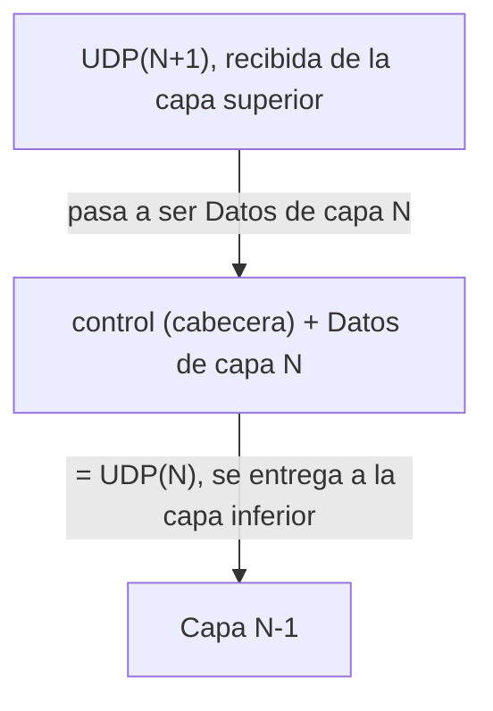

# Encapsulamiento: resumen y ejercicio

> Basado en la Presentación 2 (Modelo ISO-OSI), Ing. M.Sc. Roberto Zambrana Flores.
> **Siglas de esta presentación (no son nomenclatura estándar):**
> - **UDP** = *Unidad de Datos de Protocolo* (PDU en inglés). **No** es el protocolo UDP de transporte.
> - **AH, PH, SH, TH, RH, EH** = siglas de las figuras para las cabeceras de cada capa (siguen la inicial de la capa). La diapo no las define explícitamente.
> - **H2, H3, H4, T2** = siglas del ejemplo "Tengo una idea.": el número es la capa; H es cabecera y T2 es la cola de enlace.

---

## 1. Qué es

**Encapsulamiento:** operación de "encerrar" el mensaje del nivel superior **detrás de una cabecera** (*header*) en el mensaje del nivel inferior. Es el proceso de incorporar un **campo de control** a una UDP.

Información de control típica: dirección, control de errores, etc.

## 2. Las partes

| Parte | Qué es | Dónde va |
|---|---|---|
| **Cabecera / encabezamiento / header** | Información de control que usan los **pares** para comunicarse | **Al inicio** del mensaje |
| **Cola** | Información de control adicional | **Al final** (en la figura, solo **Enlace** la agrega: `T2`) |
| **Payload / cuerpo del mensaje / carga útil** | Los datos que entregó la capa superior | Dentro del mensaje de la capa inferior |
| **UDP(N)** | Unidad de datos de la capa N | `control + Datos de capa N` |
| **DSU** | Nombre que da la diapo a los "Datos de capa N" (lo que llega de N+1) | El payload de la capa N |
| **Llave de multiplexación** | Permite entregar el mensaje al **protocolo correcto dentro de una capa** | Se usa al recibir |

## 3. Regla por capa



- Cada capa **brinda servicios a la superior y recibe servicios de la inferior**.
- Cada capa en TX (transmisión) **recibe la UDP(N+1), le agrega una cabecera y entrega la UDP(N)** a la capa inferior.
- La capa inferior **no sabe** si el contenido es una imagen, un correo o una secuencia numérica: solo lo trata como payload.

## 4. Cómo se comporta

**Emisor: el mensaje "baja"**, ganando una cabecera por capa.

| Capa | Unidad de datos | Cabecera |
|---|---|---|
| Aplicación (7) | UDP de Aplicación | AH |
| Presentación (6) | UDP de Presentación | PH |
| Sesión (5) | UDP de Sesión | SH |
| Transporte (4) | **Segmentos** | TH |
| Red (3) | **Paquetes** | RH |
| Enlace (2) | **Tramas** | EH **+ cola** |
| Físico (1) | **bits** | — |

**Red: el mensaje "viaja"** por la red. Los nodos intermedios solo tienen las capas 1 a 3.

**Receptor: el mensaje "sube"** por las capas en sentido inverso, hasta el usuario. (La diapo no usa la palabra "desencapsulamiento"; es el recorrido inverso de la figura del receptor.)

**Fragmentación:** si hace falta, el mensaje se **parte en bloques** y se **reensambla** en el otro extremo. Motivos: la red acepta bloques limitados, el control de errores es más eficiente con unidades pequeñas, más acceso a múltiples usuarios y buffers de recepción limitados.

## 5. Ejemplo de la diapo: "Tengo una idea."

| Capa | Resultado |
|---|---|
| Sesión (5) | `Tengo una idea.` (sin cabeceras propias en el dibujo) |
| Transporte (4) | `H4 \| Tengo una idea.` |
| Red (3) | Se parte en 2 paquetes: `H3 \| H4 \| Teng` y `H3 \| o una idea.` |
| Enlace (2) | `H2 \| H3 \| H4 \| Teng \| T2` y `H2 \| H3 \| o una idea. \| T2` |
| Físico (1) | Bits: primero la trama 1, luego la trama 2 |

**H4 viaja solo en el primer fragmento.** Cada paquete lleva su H3 y cada trama su H2 y su T2.

---

## 6. Ejercicio

**Enunciado:** el usuario del Nodo A envía `Hola a todos.` al Nodo B. Cada capa agrega su cabecera: H4 (transporte), H3 (red) y H2 (enlace, más la cola T2). La capa de red parte el segmento en 2 paquetes: el primero con `H4 + "Hola a"` y el segundo con `" todos."` (empieza con espacio).

### Solución, emisor (Nodo A)

```
Sesión (5):      Hola a todos.
Transporte (4):  [ H4 | Hola a todos. ]                      -> segmento
Red (3):         [ H3 | H4 | Hola a ]   [ H3 |  todos. ]     -> 2 paquetes
Enlace (2):      [ H2 | H3 | H4 | Hola a | T2 ]
                 [ H2 | H3 |  todos. | T2 ]                  -> 2 tramas
Físico (1):      bits de la trama 1, luego bits de la trama 2
```

### Solución, receptor (Nodo B)

```
Físico (1):      llegan los bits de las 2 tramas
Enlace (2):      [ H2 | H3 | H4 | Hola a | T2 ]  [ H2 | H3 |  todos. | T2 ]
Red (3):         [ H3 | H4 | Hola a ]  [ H3 |  todos. ]
Transporte (4):  [ H4 | Hola a todos. ]   (mensaje completo)
Sesión (5)...:   Hola a todos.            (llega al usuario B)
```

Siguiendo la figura de la diapo, el receptor ve **dos paquetes en Red** y **el mensaje completo en Transporte**: el reensamblaje ocurre entre esas dos capas.

### Preguntas rápidas

| Pregunta | Respuesta |
|---|---|
| ¿Qué capa agrega cola? | **Enlace (2)**, con T2 |
| ¿Cuántas cabeceras lleva cada trama? | Trama 1: **3** (H2, H3, H4) y 1 cola. Trama 2: **2** (H2, H3) y 1 cola |
| ¿Qué sabe una capa inferior del contenido? | **Nada**: lo trata como payload |
| ¿Cuál es la UDP de la capa 3 en el paquete 1? | `H3 + [H4 \| Hola a]` |
| ¿Para qué sirve la llave de multiplexación? | Para entregar el mensaje al protocolo correcto dentro de una capa |
