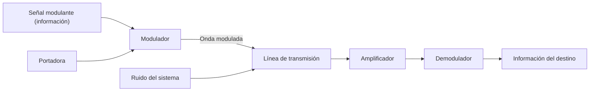
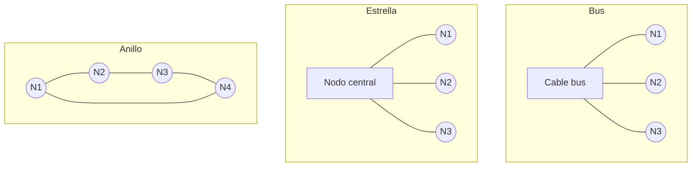

# Resumen: Presentación 1 · Fundamentos de Redes de Computadoras

> Fuente: Ing. M.Sc. Roberto Zambrana Flores. Resumen fiel a las diapositivas: no se agregó nada que ellas no digan, salvo las fórmulas y la aclaración de términos propios del curso (al final).

**Contenido de la presentación:** bases teóricas de las comunicaciones · generación, transmisión y recepción de señales · comunicaciones digitales · transmisión digital · introducción a las comunicaciones de datos · tipos de redes y su caracterización.

---

## 1. Bases teóricas de las comunicaciones

### Esquema básico de un sistema de comunicaciones

- **a) Comunicación unidireccional:** la estación A tiene la fuente y el transmisor; la estación B, el receptor y el destino.
- **b) Comunicación bidireccional:** cada estación (A y B) tiene transmisor y receptor, así que el esquema se repite en ambos sentidos.

### Medios de transmisión

**Medios guiados:** cable coaxial, par trenzado y fibra óptica.

| Medio | Lo que dice la diapositiva |
|---|---|
| **Cable coaxial** | Partes: **conductor interno**, **dieléctrico** y **conductor externo**. La figura marca las dimensiones `d` (interna) y `D` (externa). |
| **Par trenzado** | También llamado **par simétrico** o **cable entorchado** (*twisted pair*). Es el **más económico a distancias cortas**, **fácil de instalar y conectorizar**. **Práctico hasta 100 Mbit/s**, se puede utilizar **hasta 1 Gbit/s**. Se presenta como *Unshielded Twisted Pair* (UTP), con 4 pares (par 1 a par 4). |
| **Fibra óptica** | Estructura (de adentro hacia afuera): **núcleo** (*core*, 8 µm a 62.5 µm), **revestimiento** (*cladding*, 125 µm) y **recubrimiento** (*coating*, 250 µm o 900 µm). Se distinguen las **fibras monomodo** (*Single-Mode*, SM) y **multimodo** (*Multimode*, MM). |

**Medios no guiados**
- Las **ondas electromagnéticas** se pueden transmitir eficazmente mediante una **antena con dimensiones comparables a la longitud de onda** de la señal que se quiere enviar.
- El **ancho de banda máximo** que se puede transmitir es **proporcional a la frecuencia de la portadora**.

### Espectro electromagnético

- Abarca desde **30 Hz hasta 300 exahertz**.
- En términos de longitud de onda, desde las **ondas kilométricas hasta las femtométricas**.
- **c = velocidad de la luz = 300.000 km/s**.
- **f = c / λ**, donde `λ` es la longitud de onda (metros por ciclo), `c` = 300,000,000 m/s y `f` la frecuencia (hertz).
- **Frecuencias bajas tienen longitudes de onda largas, y frecuencias altas, longitudes de onda cortas.**

Lo que muestran los diagramas del espectro:

| Diagrama | Contenido |
|---|---|
| Frecuencia (Hz), de 10⁰ a 10²² | Subsónica, audio, ultrasónica, AM radio, TV/FM, **banda de radiofrecuencia**, microonda terrestre/satélite/radar, infrarrojo, visible, ultravioleta, rayos X, gamma y cósmicos. La **banda de fibra óptica** aparece sobre infrarrojo, visible y ultravioleta. |
| De menor a mayor frecuencia | Estática, baja frecuencia, radio frecuencia, infrarrojo, visible, ultravioleta, ionizante. |
| *Radio Frequency Spectrum* (30 Hz a 3000 EHz) | Ondas de radio (muy baja, baja, media, alta, muy alta frecuencia), microondas (ultra alta, super alta, extra alta frecuencia), infrarrojo, luz visible (700 nm a 400 nm), ultravioleta, rayos X y gamma. Marca AM broadcast entre 540 y 1630 kHz y FM entre 88 y 108 MHz. |

---

## 2. Generación, transmisión y recepción de señales

### Esquema funcional de un sistema completo de comunicaciones

- **Estación A:** transmisor (señal modulante, portadora y modulador).
- **Estación B:** receptor (amplificador, demodulador e información del destino).
- La onda modulada viaja por la **línea de transmisión**, donde actúa el **ruido del sistema**.

### Señal fundamental: parámetros de una señal senoidal

`v(t) = Vm · sen(ωt − φ)`

- **Vm:** amplitud.
- **ω:** frecuencia angular, **ω = 2π / T** (T = período).
- **φ:** ángulo de fase.
- **φ > 0: adelanto** (corrimiento hacia la izquierda). **φ < 0: atraso** (corrimiento hacia la derecha).

### Modulación y demodulación

- **Amplitud modulada (AM):** la **portadora** y la **señal a modular** entran a un **modulador de amplitud**, que entrega la **señal modulada por amplitud**.
- La diapositiva compara en una misma figura: (a) la señal modulante, (b) la portadora, (c) **modulación de frecuencia (FM)** y (d) **modulación de fase (PM)**.
- **Modulación angular (desfasamiento en señales senoidales):**
  - `v1(t) = 100 sen(t) V`
  - `v2(t) = 100 sen(t − 45) V` (señal atrasada 45°)
  - `v3(t) = 100 sen(t + 45) V` (señal adelantada 45°)
  - Forma general: `v1(t) = Vm1 sen(ωt + α)` y `v2(t) = Vm2 sen(ωt + β)`

---

## 3. Comunicaciones digitales

### Señales digitales

- La mayor parte de lo que percibimos del mundo son **fenómenos que existen en el tiempo**. Los mensajes están asociados a variables físicas (la presión en el oído, ondas luminosas en la vista, etc.) que pueden interpretarse como **funciones reales de variable real, D = x(t)**.
- El tiempo es continuo y las funciones son continuas. A estas señales se las llama **señales analógicas**.
- Las **computadoras no pueden trabajar directamente con señales analógicas** (continuas). Hay que transformarlas en **discretas**, tomando los valores de la función en diferentes valores del tiempo: **x(n₀) = x(t) en t = n₀**.
- Físicamente esto se implementa en un **convertidor analógico a digital (A/D)**.

### Conversión análoga-digital

- Se transforma una función real en una **sucesión de números reales**: **{x(nT)} = x(T), x(2T), … x(NT)**.
- La variable se transforma en un **número entero**, de modo que se puede almacenar en un **número finito de bits**.
- **El problema:** decidir cuál debe ser el **intervalo T**, de modo que no se pierdan las características esenciales de la señal.

Ejemplo de la diapositiva (niveles de 0 a 7):

| Etapa | Valores |
|---|---|
| Muestreo | 5.2, 6.3, 6.8, 5.5, 4.0 |
| Cuantificador | 5, 6, 7, 6, 4 |
| Codificador | 101, 110, 111, 110, 100 |

### Teorema de Nyquist

`x(t)` puede ser recuperada con precisión, y los datos `x(nT)` contienen toda la información necesaria para reconstruir la señal analógica, si el inverso del intervalo (la frecuencia elegida) cumple:

**fs = 1/Ts > 2 · fmax**

donde **fmax es la frecuencia máxima de la señal**.

---

## 4. Transmisión digital

### Modulación de señales digitales

Se parte de la expresión **A · cos(2π·fc·t + φ)**, donde se identifican tres parámetros: **amplitud (A)**, **frecuencia (fc)** y **fase (φ)**. Con la secuencia de bits `0 1 0 1 0` se muestran:

| Sigla | Nombre en la diapositiva |
|---|---|
| **ASK** | Modulación de amplitud |
| **FSK** | Modulación de frecuencia |
| **PSK** | Modulación de fase |

### Modulación por desplazamiento de fase

La **constelación x-PSK** de señales para **M = 2, 4 y 8**:

| Constelación | M | Puntos (valores de bits) |
|---|---|---|
| **BPSK** | 2 | 0, 1 |
| **QPSK** | 4 | 00, 01, 10, 11 |
| **8-PSK** | 8 | 000, 001, 010, 011, 100, 101, 110, 111 |

---

## 5. Introducción a las comunicaciones de datos

### Evolución de la teleinformática

Se grafica con dos ejes que convergen en la **teleinformática**:

| Eje | Etapas que aparecen |
|---|---|
| **Informática** | computadoras → multiproceso → procesos distribuidos |
| **Tecnología (en el mismo gráfico)** | válvula → transistor → circuitos integrados → LSI → VLSI |
| **Telecomunicaciones** | teléfono → transmisión analógica → transmisión digital → red digital → RDSI |

### Sistema básico de transmisión de datos

**fuente → transmisor → medio de transmisión → receptor → destino**

Las magnitudes en cada punto son: **información** (sale de la fuente), **señal transmitida**, **señal recibida** e **información recuperada** (llega al destino).

### Codificación

- **Hacia el canal:** fuente → **codificación de fuente** → **cifrado** → **codificación de canal** → transmisor → **canal**.
- **Desde el canal:** canal → receptor → **decodificación de canal** → **descifrado** → **decodificación de fuente** → destino.

### Efectos indeseables de la transmisión

Sobre un **pulso rectangular** la diapositiva muestra cuatro efectos: **atenuación, distorsión, interferencia y ruido**. Los presenta con gráficos de cómo queda el pulso; no los define en texto.

### Simultaneidad emisión-recepción

| Modo | Lo que dice la diapositiva |
|---|---|
| **Simplex** (Tx → Rx) | **Transmite en una sola dirección.** Típico de los sistemas de difusión. |
| **Semiduplex** (*half duplex*) | **Transferencia de información en ambos sentidos pero NO simultáneamente.** |
| **Duplex** (*full duplex*) | **Transmite y recibe simultáneamente.** |

---

## 6. Tipos de redes y su caracterización

### ¿Qué es una red telemática?

**Red:** conjunto de dispositivos físicos ("hardware") y de programas ("software") mediante el cual podemos **comunicar computadoras para compartir recursos** (discos, impresoras, programas, información, etc.), así como "trabajo". Hoy sus funciones pueden dividirse en las **siete capas** propuestas por **ISO** para su **modelo de sistemas abiertos (OSI)**.

### Criterios de clasificación

1. **Por su extensión:** LAN, MAN (nivel frontera) y WAN.
2. **Por su tipología o arquitectura**, en base a: técnicas de Tx, método de acceso al medio (arbitraje) y topología.

### Por su extensión

| Tipo | Lo que dice la diapositiva |
|---|---|
| **LAN** (*Local Area Network*) | Generalmente **privadas o institucionales**. De **pocos kilómetros** de extensión. Interconectan computadoras y equipos para compartir recursos e información. Por lo general emplean **tecnologías de difusión**. Operan generalmente de **10 Mbit a 100 Mbit**. |
| **MAN** | Aparece en la lista como "MAN (nivel frontera)", sin más detalle. |
| **WAN** (*Wide Area Network*) | Se extienden sobre un **área geográfica extensa**. Por lo general emplean, en la interconexión de LANs, **ruteadores** y actualmente **conmutadores multicapa**. En esa interconexión generalmente son **redes punto a punto**. |

### Por técnicas de transmisión

| Tipo | Lo que dice la diapositiva |
|---|---|
| **Redes de difusión** | Tienen un **único canal de Tx compartido** por todos los nodos conectados a la red. Todos los nodos pueden "ver" la información y es un **código** quien define para quién es. |
| **Redes punto a punto** | La información puede pasar por **varios equipos de cómputo** antes de llegar a su destino, y puede hacerlo por **diferentes caminos**. |

### Por método de acceso al medio

En las redes de difusión se impone un método que defina **quién toma el medio de Tx**.

| Método | Lo que dice la diapositiva |
|---|---|
| **CSMA/CD** (*Carrier Sense Multiple Access with Collision Detection*) | Estandarizado por **IEEE 802.3**. Es la **más utilizada en topologías de bus y estrella**. Cada nodo **censa la disponibilidad del medio** y un **acceso múltiple (colisión) se soluciona**. |
| **Token passing** (paso del token) | Estandarizado por **IEEE 802.4**. Los nodos se pasan un **token** que les dice el momento en que pueden transmitir por el medio. **Asegura que todos tendrán su momento** de tomar el medio. |

### Por topología

La topología se refiere a la **distribución física y forma de conexión de los nodos**: **bus, estrella, anillo e híbridas**.

| Topología | Lo que dice la diapositiva |
|---|---|
| **Bus** | Los nodos se conectan **linealmente**, uno a continuación de otro. **Menor acumulación de cables.** **Propenso a fallos**: una interrupción en cualquier punto del bus provoca el fallo de toda la red. **Complejidad** en la detección de averías. Requiere **terminadores de 50 ohmios** en ambos extremos del bus y una **"T"** para cada nodo. **Es simple agregar nuevos nodos.** Utiliza **cable coaxial** y alcanza los **10 Mbit**. |
| **Estrella** | La caracteriza un **nodo central** al que se conectan directamente los restantes nodos. **Se reducen las probabilidades de fallo** por causas del cableado, y se pueden **aislar los nodos con problemas** sin afectar al resto. El **punto crítico es el nodo central**, que es fácil y rápido de sustituir. **Fácil identificación de los fallos.** Por su envergadura, el cableado **exige una mejor planificación** y una concepción perspectiva que simplifique agregar nuevos nodos. |
| **Anillo** | Se conectan **todos los nodos en un lazo cerrado**. Para el control del medio se emplea el **token**, transferido de nodo en nodo. El **cableado es complejo**, no así el proceso de agregar nuevos nodos. Son **fiables**: durante la reparación no se afectan los otros nodos de la red. La red más conocida con esta topología es **Token Ring**. |

### Tecnologías de redes locales

**Ethernet · Fast Ethernet · Gigabit Ethernet · Token Ring · FDDI**

### Trabajo en el curso

Grupos de 2 o 3 personas. Cada miembro analiza y reflexiona sobre las redes que conoce y recuerda y registra sus características. Se discute en el equipo cuál es la más completa y se comparte la descripción con el curso.

---

## Fórmulas de la presentación

| Fórmula | Significado |
|---|---|
| `f = c / λ` | Relación entre frecuencia, velocidad de la luz y longitud de onda. `c` = 300.000 km/s. |
| `v(t) = Vm · sen(ωt − φ)` | Señal senoidal: amplitud `Vm`, frecuencia angular `ω`, ángulo de fase `φ`. |
| `ω = 2π / T` | Frecuencia angular en función del período `T`. |
| `v(t) = Vm · sen(ωt + α)` | Forma general de la modulación angular (desfasamiento). |
| `x(n₀) = x(t)` en `t = n₀` | Se toman los valores de la función en instantes discretos. |
| `{x(nT)} = x(T), x(2T), … x(NT)` | Señal muestreada: sucesión de valores cada intervalo `T`. |
| `fs = 1/Ts > 2 · fmax` | **Teorema de Nyquist** para elegir la frecuencia de muestreo. |
| `A · cos(2π·fc·t + φ)` | Portadora que se modula en amplitud (ASK), frecuencia (FSK) o fase (PSK). |

---

## Términos propios de esta presentación

| Término | Cómo lo usa la presentación |
|---|---|
| **Tx / Rx** | Abreviaturas de **transmisión/transmisor** y **recepción/receptor** (por ejemplo, "técnicas de Tx", "medio de Tx", el esquema Tx → Rx). |
| **Nodo** | Cada equipo conectado a la red (computadora o dispositivo) en las topologías y en los métodos de acceso. |
| **Señal modulante** | La **información** que se quiere enviar; entra al modulador junto con la portadora. |
| **Portadora** | La señal que se modula. Su frecuencia limita el ancho de banda máximo en los medios no guiados. |
| **Onda modulada** | La salida del modulador, la que viaja por la línea de transmisión. |
| **Teleinformática** | Nombre del punto donde convergen la **informática** y las **telecomunicaciones** en el gráfico de evolución. |
| **Red telemática** | Título de la diapositiva que define "red" (hardware + software para compartir recursos y trabajo). |
| **Arbitraje** | Sinónimo que da la diapositiva para el **método de acceso al medio**: el que define quién toma el medio de Tx. |
| **Nivel frontera** | Texto que acompaña a MAN en la lista de redes por extensión. La diapositiva no lo explica. |
| **x-PSK, M** | `M` es el número de posiciones de la constelación; "x-PSK" es la forma genérica (BPSK con M=2, QPSK con M=4, 8-PSK con M=8). |
| **RDSI, LSI, VLSI** | Siglas que aparecen en el gráfico de evolución sin desarrollarse. RDSI = Red Digital de Servicios Integrados; LSI y VLSI = integración a gran escala y a muy gran escala (*Large Scale Integration* y *Very Large Scale Integration*). |
