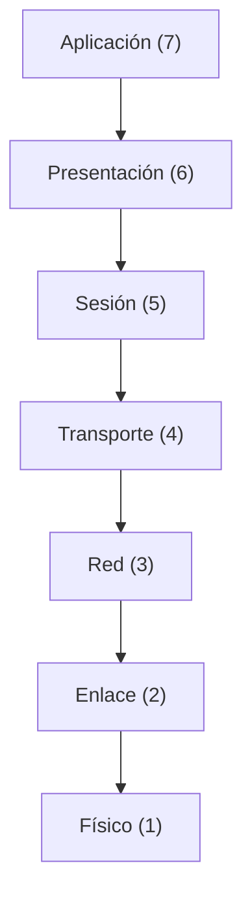
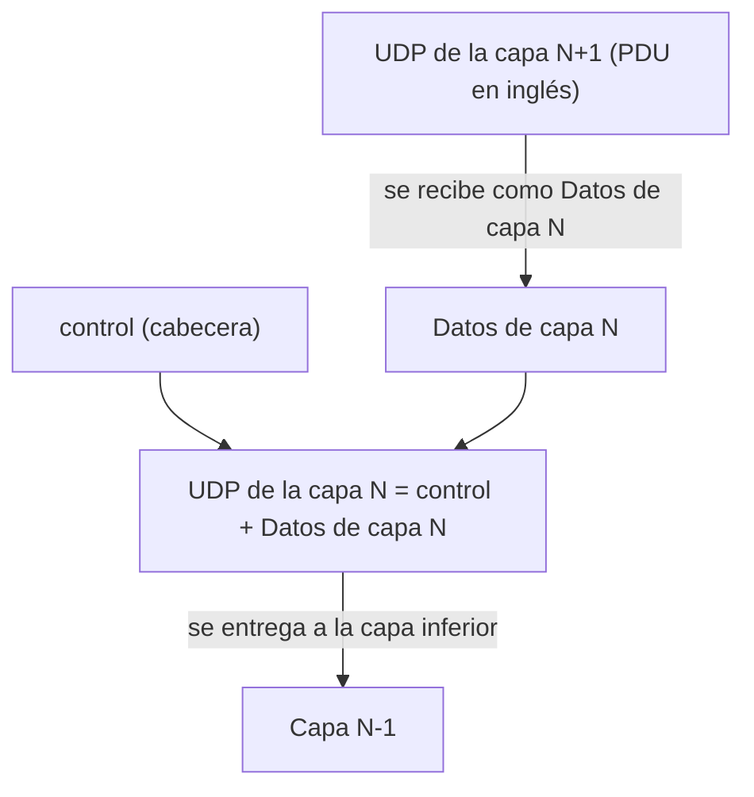
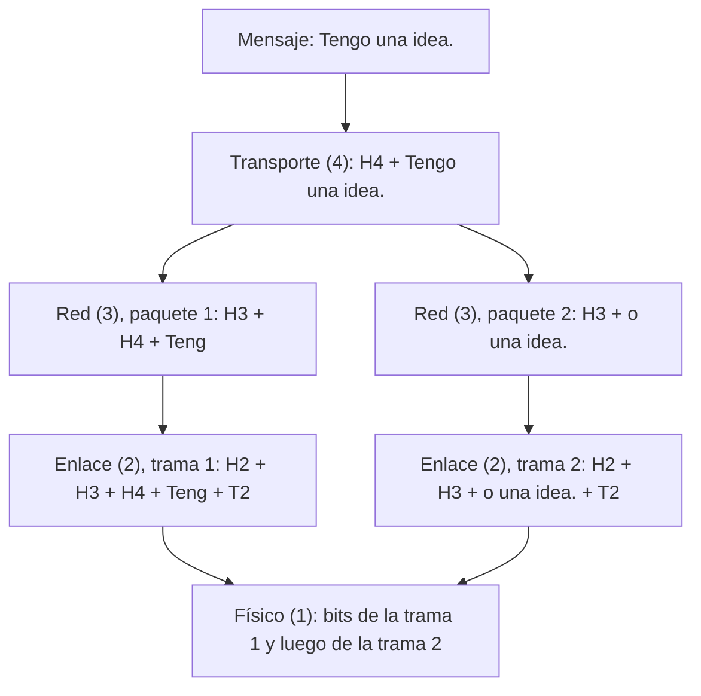

# Resumen: Presentación 2 · Modelo ISO-OSI

> Fuente: Ing. M.Sc. Roberto Zambrana Flores. Resumen fiel a las diapositivas: no se agregó nada que ellas no digan, salvo la aclaración de términos y siglas propios de esta presentación (en el texto y en la tabla final). **La presentación no trae fórmulas.**

---

## 1. Protocolos

**Idea base:** para que dos entidades se comuniquen exitosamente deben **hablar el mismo lenguaje**. Deben acordar **qué** se comunican, **cómo** se comunican y **cuándo** se comunican.

> **Protocolo:** conjunto de reglas que gobiernan el intercambio de datos entre dos entidades **a igual nivel**, tanto para la transmisión como para el **control y recuperación de posibles errores**.

**Elementos a acordar** para una transferencia exitosa de datos por una red: conectores a emplear, voltajes de señal, formato de señal, técnica de control de errores, direccionamiento, técnica de conmutación, etc.

**Funciones de los protocolos:** fragmentación y reensamblaje, **encapsulamiento**, control de flujo, control de errores, sincronización, direccionamiento, multiplexación, etc.

### Fragmentación y reensamblaje

La entidad de protocolo del usuario A **fragmenta** el mensaje en bloques; la entidad de protocolo del usuario B los **reensambla** y los entrega al usuario B.

**Motivos de fragmentación:**
- La red de comunicación acepta **bloques de tamaño limitado**.
- El **control de errores es más eficiente** con unidades de tamaño limitado.
- **Mayores posibilidades de acceso** a múltiples usuarios.
- **Limitado tamaño de los buffers** de recepción.

---

## 2. División en niveles, arquitectura de red y servicios

### División en niveles

- Se asume que el **nivel N** en una computadora se comunica con el **nivel N** en otra computadora siguiendo una serie de **reglas y convenciones**.
- A ese conjunto de reglas y convenciones se le conoce como **protocolo del nivel N**.
- Los dos niveles N que conversan son **procesos pares a nivel N**. El protocolo del nivel N+1 vive entre los niveles N+1 de ambas computadoras, y el del nivel N entre los niveles N. Abajo de todo está el **medio físico**.

### Arquitectura de red

- Es el **conjunto de niveles, interfaces entre ellos y protocolos de nivel** con que es posible definir e implementar una red de datos.
- Sus especificaciones deben tener **suficiente información** para que quienes la implementen escriban los programas y diseñen el hardware de cada nivel de modo que cumplan los protocolos.

### Servicios

- **Nivel N+1:** usuario de los servicios del nivel N.
- **Nivel N:** proveedor de servicios al nivel N+1 (y, a la vez, usuario de los servicios del nivel N−1).
- Cada capa **brinda servicios a su capa superior y recibe servicios de su capa inferior**.

| Tipo de servicio | Lo que dice la diapositiva | Ejemplo |
|---|---|---|
| **Orientado a conexión** | Primero se **establece** la conexión, luego se **utiliza** y por último se **termina**. | **Sistema telefónico**: levanta el teléfono, marca, habla y cuelga. La conexión actúa como un **tubo**. |
| **No orientado a conexión** | Cada mensaje es **autocontenido**: lleva consigo la **dirección completa del destino** y se encamina en forma **independiente** a través de la red. | **Correo postal**: cada carta tiene su dirección destino y se envía independiente de las demás. |

---

## 3. Modelo de referencia OSI

- El modelo OSI **no es una arquitectura de red**, porque **no especifica los protocolos y servicios** a usar en cada nivel. **Solo dice qué debe hacer cada nivel.**
- La **ISO** ha producido estándares para todos los niveles del modelo, aunque **no forman parte del mismo**. Cada estándar se ha publicado de manera separada.
- **Importante:** el modelo OSI es un modelo de referencia, pero **NO define regla alguna de cómo ejecutar las funciones**. No define protocolo alguno, **solo estructura funciones por capas**.

### Los 7 niveles

---

## 4. Encapsulamiento

### 4.1 Concepto

- Es el proceso de **incorporar un campo de control** a una **Unidad de Datos de Protocolo (UDP)**. En esta presentación **UDP** es la sigla de *Unidad de Datos de Protocolo* (**PDU** en inglés); **no** es el protocolo UDP de transporte.
- **Información de control:** dirección, control de errores, etc.
- Cuando un protocolo de una **capa superior** envía datos a su **par** en otro nodo, los **entrega al protocolo de la capa inferior**.
  - El protocolo de la capa inferior **no sabe** si el nivel superior envía una imagen, un correo o una secuencia numérica.
- Para crear su mensaje, el protocolo del nivel inferior **agrega información de control** (**cabecera** o **encabezamiento**, *header*), que se usa entre pares para comunicarse.
  - Generalmente la cabecera va **al iniciar** el mensaje.
  - En algunos casos se anexa información de control **al final** del mensaje, y se llama **COLA**.
- A los datos entregados por la capa superior, dentro del mensaje, se les llama **cuerpo del mensaje** o **payload**.
- **Encapsulamiento** = la operación de "encerrar" el mensaje del nivel superior **detrás de una cabecera** (*header*) en el mensaje del nivel inferior.

### 4.2 Regla por capa

- Los protocolos se estructuran **de forma jerárquica por capas**.
- **Cada capa en TX** (TX = transmisión) **recibe la UDP(N+1)** de su capa superior, **le agrega una cabecera (control)** y **entrega a su capa inferior la UDP(N)**.
- **UDP de la capa N = control + Datos de capa N.** Los "Datos de capa N" son lo que llega de la capa N+1; la diapositiva los llama **DSU** (*Unidad de Datos de Servicio*) y los marca con asterisco.

### 4.3 Datos a través del modelo (emisor)

| Capa | Unidad de datos | Cabecera que agrega |
|---|---|---|
| Aplicación (7) | UDP de Aplicación | **AH** |
| Presentación (6) | UDP de Presentación | **PH** |
| Sesión (5) | UDP de Sesión | **SH** |
| Transporte (4) | **Segmentos** | **TH** |
| Red (3) | **Paquetes** | **RH** |
| Enlace (2) | **Tramas** | **EH** (y además una **cola**) |
| Físico (1) | **bits** | — |

> **Aclaración de siglas:** **AH, PH, SH, TH, RH y EH** son mnemónicos que usa **solo esta presentación** en sus figuras (no son nomenclatura estándar). La diapositiva no las define explícitamente: siguen la inicial de cada capa y se usan como cabeceras.

- La aplicación entrega el mensaje a la capa 7 y este **va "bajando"** capa por capa, ganando una cabecera en cada una.
- Solo el **enlace** agrega también una **cola** al final de la trama (en las figuras, `T2`).

### 4.4 Trayectoria real de la comunicación

- Al **enviar**, el mensaje **baja** por las capas del nodo A. Luego **viaja** a través de la red. Al **recibir**, **sube** por las capas del nodo B.
- Cada capa **conversa con su par** (protocolo de aplicación, de presentación, de sesión, de transporte, de red, de enlace y físico), pero físicamente todo pasa por la **red**.
- En la vida real, las 7 capas se construyen normalmente como **combinación** de:
  1. **Sistema operativo** (Windows XP, Win2003, Mac/OS o Unix).
  2. **Aplicaciones** (navegador, cliente de correo, servidor web).
  3. **Protocolos de transporte y de red** (TCP/IP, IPX/SPX, SNA).
  4. **Hardware y software** que colocan la señal en el cable conectado al computador (**tarjeta de red y driver**).

### 4.5 Ejemplo de la diapositiva: el mensaje "Tengo una idea."

El usuario en el **Nodo A** envía "Tengo una idea." Los datos se encapsulan y **se registra a qué protocolo de la capa superior le pertenece la carga útil (payload)**.

> **Aclaración de siglas:** **H2, H3, H4 y T2** son mnemónicos que usa **solo esta figura** (no son nomenclatura estándar). El número indica la capa (2 enlace, 3 red, 4 transporte); H2, H3 y H4 aparecen como cabeceras y T2 como la cola de enlace. La diapositiva no define las letras explícitamente.

| Capa | Lo que se ve en la figura |
|---|---|
| **Sesión (5)** | `Tengo una idea.` (llega sin cabeceras propias en el dibujo) |
| **Transporte (4)** | `H4 │ Tengo una idea.` (le agrega **H4**) |
| **Red (3)** | **Se parte en dos paquetes**, cada uno con su **H3**: `H3 │ H4 │ Teng` y `H3 │ o una idea.` |
| **Enlace (2)** | A cada paquete le agrega **H2 al inicio y T2 al final**: `H2 │ H3 │ H4 │ Teng │ T2` y `H2 │ H3 │ o una idea. │ T2` |
| **Física (1)** | Sale la secuencia de bits: primero la trama 1 y después la trama 2. |

> Observa que **H4 viaja solo en el primer fragmento** (junto a `Teng`). El segundo (`o una idea.`) lleva únicamente H3, H2 y T2.

### 4.6 Lo que pasa en el receptor (Nodo B)

El usuario en el **Nodo B** recibe "Tengo una idea." **subiendo** por las capas, en sentido inverso:

1. **Físico (1):** llegan los bits de las dos tramas.
2. **Enlace (2):** se reciben las tramas `H2 │ H3 │ H4 │ Teng │ T2` y `H2 │ H3 │ o una idea. │ T2`.
3. **Red (3):** se reciben los paquetes `H3 │ H4 │ Teng` y `H3 │ o una idea.`
4. **Transporte (4):** aparece el mensaje completo con su cabecera: `H4 │ Tengo una idea.`
5. **Sesión (5)** y superiores: se entrega `Tengo una idea.`

> **Llave de multiplexación:** para entregar el mensaje al **protocolo correcto dentro de una capa** se usa la llave de multiplexación.

### 4.7 Dónde existe cada capa

- Los **protocolos de alto nivel** (capas 4 a 7) están **solo en los extremos** (A y B).
- Los **protocolos de bajo nivel** (capas 1 a 3) están en **la red y en los extremos**: también en los nodos intermedios.
- La capa de red es **la más baja que se ocupa de la transmisión extremo a extremo** y **la más alta que se reproduce en los dispositivos de la subred**.

---

## 5. Capas inferiores: Física y Enlace de Datos

### Capa o nivel Físico

- **Recibe la información de la capa de enlace** y la **entrega al medio de comunicación**.
- **Establece las relaciones con el medio** de comunicación.
- Responsable de la **transferencia** (transmisión/recepción) de unidades básicas de información (**bits**) **no estructurados**, sobre líneas físicas de transmisión.

**Forman parte de los protocolos del nivel físico:**
- **Características mecánicas:** conectores, etc., y las características del medio de transmisión.
- **Características eléctricas de la señal:** niveles y formato de señal, tipo de modulación, tipo de codificación de línea.

**Codificación de línea:** debe garantizar, por ejemplo, que si se transmite un "1" se reciba un "1" y no un "0", y **cuántos volts representan un "1" y cuántos un "0"**.

### Capa o nivel de Enlace

- **Enlace:** la comunicación establecida entre **dos recursos conectados directamente entre sí**.
- **Función:** transferencia de **bloques de información entre equipos directamente conectados**.
- Entre dos equipos finales puede haber varios nodos y por lo tanto **varios enlaces**.

Lo que hace:
- Proporciona una **interfaz de servicio a la capa de red**.
- **Recibe paquetes** del nivel de red y **entrega tramas** al nivel físico. **Estructura la trama**: toma el paquete (UDP de la capa de red) y lo coloca en el **campo de datos de la trama** (UDP de la capa de enlace), con **encabezamiento y cola**.
- Hace **control de errores**, transformando el canal en un enlace **virtualmente libre de errores**.
- Es responsable de la transmisión de **tramas entre dos máquinas directamente conectadas**.
- Garantiza **control de flujo** entre dos capas de enlace.
- **Administra el enlace** (quién lo establece, quién hace uso del medio de transmisión común, etc.).

---

## 6. Capa o nivel de Red

- Una comunicación puede implicar **múltiples enlaces**, por lo que deben tomarse **decisiones de encaminamiento**.
- Es responsable del **enrutamiento**, para conectar sistemas abiertos **no directamente conectados**, además del **direccionamiento lógico**.
- Transporta **paquetes** a lo largo de la red.
- **Controla la congestión** y la **contabilidad** de la red.
- Se ocupa de aceptar **segmentos** de la capa de transporte de la estación fuente, **crear paquetes** y encaminarlos por toda la ruta hasta la capa de transporte de la estación destino.
- Es la capa más baja que se ocupa de la transmisión **extremo-extremo** y la más alta que se reproduce en los dispositivos de la subred.
- Otra función importante: la **interconexión de redes heterogéneas**.
- **Comunicación extremo a extremo** (figura de la diapositiva): los equipos de los extremos tienen las capas T, R, E y F; los nodos de la sub-red solo R, E y F. Entre las capas R hay una **comunicación virtual de capa de red** (línea punteada), aunque físicamente el camino pasa por las capas inferiores (E y F) de cada enlace.

---

## 7. Capa o nivel de Transporte

- **Protocolo extremo a extremo**, concebido para realizar **transferencia fiable e2e** (e2e = extremo a extremo, abreviatura de la diapositiva), ofreciendo una **calidad de servicio uniforme**.
- **Asimila los mensajes de la capa de sesión**, los **divide en segmentos** si fuera necesario y los entrega a la capa de red, asegurando que lleguen **correctamente, en orden** y, si fuera necesario, **reensamblados** en el otro extremo.
- Garantiza la **integridad y el orden** de la información transmitida.
- Decide, según la aplicación, **qué servicios solicitará de la capa de red**.
- Si se necesita un **gran caudal**, puede solicitar **múltiples conexiones de red**.
- Si la conexión resulta **muy costosa**, puede **multiplexar varias conexiones** a través de una misma conexión de red.
- Opera de **origen a destino** (extremo a extremo).

---

## 8. Capas o niveles de Sesión, Presentación y Aplicación

### Nivel de Sesión

- Permite el **establecimiento de una sesión** entre aplicaciones y el **control** de la misma.
- Gestiona el **control del diálogo**: en una sola dirección en cada momento, o bidireccional.
- Ante una **interrupción**, define **quién la reanuda y a partir de dónde**.
- Se encarga de la **sincronización** (inserta **puntos de verificación** en el flujo de datos).

### Nivel de Presentación

- Establece los aspectos de **sintaxis y semántica** de la información que se transmite, y la **codificación** (ASCII, EBCDIC, etc.).
- Si hay **compactación** de la información, esta es la capa encargada.
- Si se establece **cifrado**, la capa de aplicación se la entrega a presentación para que la **cifre**, y la capa de presentación del receptor la **descifra**.
- Deberá resolver los **problemas de diferencias en la codificación** en los equipos finales.

### Nivel de Aplicación

- A este nivel **interactúan los usuarios finales** de la red.
- Garantiza la **adecuada comunicación entre las aplicaciones** (e-mail, transferencia de ficheros, terminal virtual, etc.).
- **Adecua la información** a transferir a las condiciones de los equipos finales.

---

## Términos propios de esta presentación

| Término | Cómo lo usa la presentación |
|---|---|
| **UDP** | **Unidad de Datos de Protocolo** (en inglés **PDU**). Es el bloque que maneja cada capa: control + datos. **No es el protocolo UDP de transporte**; aquí siempre es "unidad de datos". |
| **UDP(N)** | La UDP de la capa N: `control + Datos de capa N`. |
| **DSU** | *Unidad de Datos de Servicio*: los "Datos de capa N", es decir lo que la capa N recibe de la capa N+1 (la UDP de N+1). |
| **Entidad de protocolo** | El elemento de cada lado que implementa un protocolo (aparece en los esquemas de fragmentación y encapsulamiento). |
| **Procesos pares / entidades a igual nivel** | Los dos niveles N (uno en cada computadora) que conversan con el protocolo del nivel N. |
| **Cabecera / encabezamiento / header** | Información de control agregada **al inicio** del mensaje. |
| **Cola** | Información de control agregada **al final** del mensaje (en el enlace). |
| **Cuerpo del mensaje / payload / carga útil** | Los datos entregados por la capa superior, dentro del mensaje de la capa inferior. |
| **AH, PH, SH, TH, RH, EH** | **Mnemónicos exclusivos de esta presentación** (no son nomenclatura estándar): cabeceras de aplicación, presentación, sesión, transporte, red y enlace. La diapositiva solo escribe las siglas, que siguen la inicial de cada capa. |
| **H2, H3, H4, T2** | En el ejemplo de "Tengo una idea.": cabecera de enlace (2), de red (3) y de transporte (4); y **cola** de enlace (2). **Mnemónicos exclusivos de esta figura** (no estándar): el número es la capa y la diapositiva no define las letras explícitamente. |
| **Llave de multiplexación** | Campo/dato que permite entregar el mensaje al **protocolo correcto dentro de una capa**. |
| **TX / e2e** | TX = transmisión; e2e = extremo a extremo. Abreviaturas propias de la diapositiva. |
| **Sistemas abiertos** | Los sistemas que la capa de red conecta aunque no estén directamente conectados. |
| **Subred (sub-red)** | La parte de la red formada por los nodos intermedios entre los extremos. |
